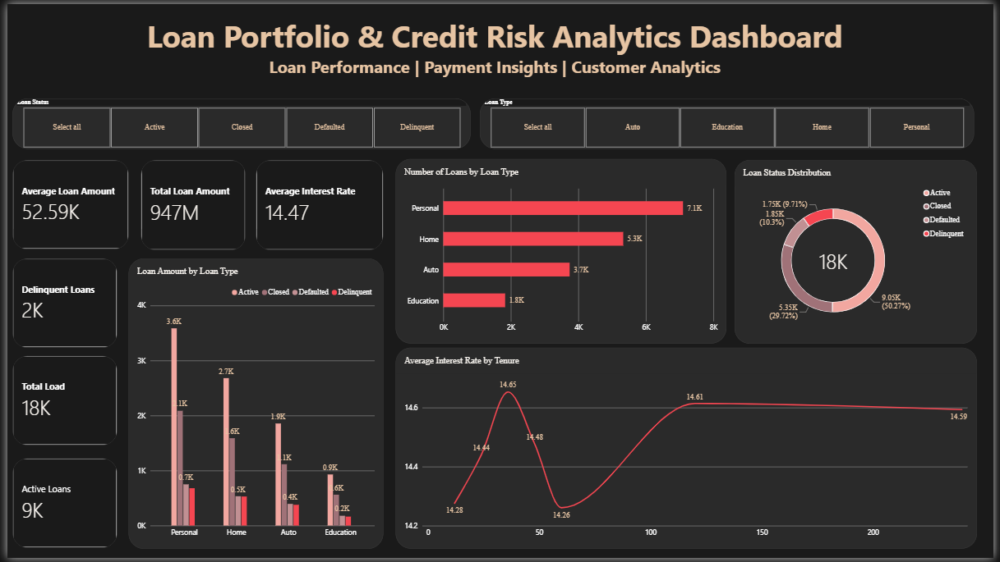
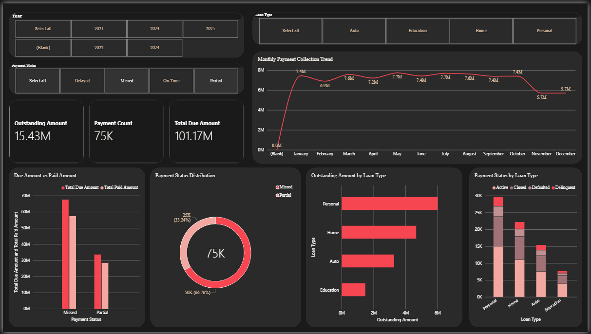
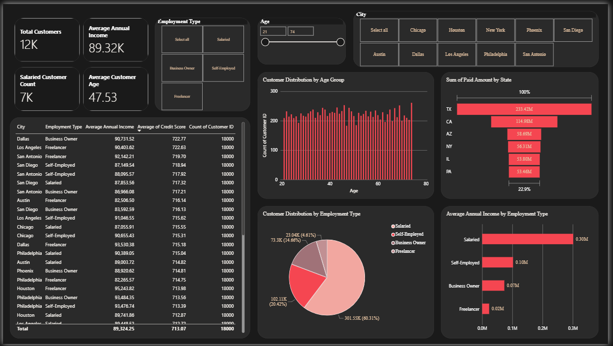

# LOAN PORTFOLIO & CREDIT RISK ANALYTICS DASHBOARD
## Power BI Project Report

### 1. Introduction

The Loan Portfolio & Credit Risk Analytics Dashboard is a data analytics and visualization project developed using Microsoft Power BI. The main purpose of this project is to analyze loan performance, monitor payment collections, and understand customer financial profiles.

The dashboard combines loan information with customer details and payment records to provide a comprehensive view of loan portfolio performance. It helps analyze loan amounts, loan status, outstanding payments, payment behavior, customer income, and credit scores.

Interactive visualizations, KPI cards, tables, and filters are used to explore financial data and identify patterns in loan performance and payment collections. The dashboard supports better financial monitoring and data-driven decision-making.

### 2. Objectives

- To analyze overall loan portfolio performance.
- To understand loan distribution by loan type and loan status.
- To monitor total due amounts, paid amounts, and outstanding balances.
- To analyze payment behavior and identify delayed payments.
- To understand customer demographics and financial profiles.
- To compare customer income, credit scores, and employment types.
- To identify potential indicators of credit risk.
- To create interactive dashboards using Power BI.
- To generate meaningful insights from customer, loan, and payment data.

### 3. Tools and Technologies Used

- **Microsoft Power BI Desktop:** Used to develop interactive dashboards and visualize financial information.
- **CSV Datasets:** Used to store loan, customer, and payment records.
- **Power Query Editor:** Used for data cleaning, transformation, and preparation.
- **DAX (Data Analysis Expressions):** Used to calculate KPIs and financial performance indicators.
- **Power BI Model View:** Used to establish relationships between datasets.
- **Power BI Visualizations:** Used to represent loan performance, payment collections, and customer financial information.
- **GitHub:** Used to store and share project files and documentation.

### 4. Dataset Description

The project uses three CSV datasets containing loan details, customer information, and payment records.

**4.1 Loans Dataset (`loans.csv`)**

This dataset contains loan-related information used to analyze loan portfolio performance.

Important fields include:
- Loan ID
- Customer ID
- Loan Type
- Loan Amount
- Interest Rate
- Tenure
- Loan Status

**4.2 Customers Dataset (`customers.csv`)**

This dataset contains customer information used to understand customer demographics and financial profiles.

Important fields include:
- Customer ID
- Age
- City
- State
- Annual Income
- Credit Score
- Employment Type

**4.3 Payments Dataset (`payments.csv`)**

This dataset contains payment information used to analyze payment collections and outstanding amounts.

Important fields include:
- Payment ID
- Loan ID
- Customer ID
- Due Date
- Payment Date
- Due Amount
- Paid Amount
- Payment Status

The three datasets work together to provide a consolidated view of loan information, customer profiles, and payment performance.

### 5. Methodology

The project follows a systematic data analytics process.

**Step 1: Data Import**

The three CSV datasets were imported into Microsoft Power BI Desktop for analysis.

**Step 2: Data Cleaning and Transformation**

The datasets were examined using Power Query Editor. Column names, data types, missing values, duplicate records, and inconsistent values were checked. Date and numerical columns were prepared for analysis wherever necessary.

**Step 3: Data Modeling**

Relationships were established between the Customers, Loans, and Payments datasets using common identifiers. The Customers table was connected to the Loans table using Customer ID, and the Loans table was connected to the Payments table using Loan ID.

**Step 4: DAX Measure Creation**

DAX measures were created to calculate important indicators such as total loan amount, total due amount, total paid amount, outstanding amount, and payment-related KPIs.

**Step 5: Loan Portfolio Analysis**

Loan records were analyzed to understand loan distribution, loan amounts, loan types, interest rates, and loan status.

**Step 6: Payment Collection Analysis**

Payment records were analyzed to compare due amounts with paid amounts and understand payment status and outstanding balances.

**Step 7: Customer Financial Analysis**

Customer information was examined to understand age distribution, annual income, credit scores, employment types, and geographical distribution.

**Step 8: Dashboard Development**

KPI cards, charts, tables, and interactive filters were used to present the analysis through three dashboard pages.

**Step 9: Dashboard Formatting and Validation**

The dashboard layout, visual formatting, calculations, relationships, and filter interactions were checked to improve readability and analytical accuracy.

## 6. Dashboard Screenshot

### 7. Results and Insights

The dashboard provides a consolidated view of loan portfolio performance, payment collections, and customer financial profiles.

- **Loan Portfolio Analysis:** Total loan amount and loan counts provide an overview of the loan portfolio.
- **Loan Status Analysis:** Loan status information helps distinguish active and delinquent loans.
- **Payment Collection Analysis:** Comparing due amounts with paid amounts helps monitor collection performance.
- **Outstanding Amount Analysis:** Outstanding balances help identify amounts that remain unpaid in the recorded payment data.
- **Payment Behavior:** Payment status information helps identify delayed and on-time payments.
- **Customer Financial Profile:** Income, credit score, age, and employment information help users understand customer characteristics.
- **Loan Type Comparison:** Loan categories can be compared to understand differences in portfolio distribution.
- **Financial Risk Monitoring:** Loan status and payment behavior provide indicators that may require further credit risk investigation.

The actual highest-performing loan category, total outstanding amount, and other numerical findings depend on the dataset values and the completed Power BI calculations.

### 8. Conclusion

The Loan Portfolio & Credit Risk Analytics Dashboard demonstrates how Microsoft Power BI can be used to analyze financial data and transform it into meaningful visual insights.

By integrating customer information, loan records, and payment data, the dashboard provides a structured view of loan portfolio performance, payment collections, and customer financial profiles. DAX measures support the calculation of key indicators, while interactive visualizations help users explore different aspects of the data.

The project helps users monitor outstanding payments, understand payment behavior, compare loan categories, and identify potential indicators that may require further financial review. It provides a practical foundation for loan portfolio monitoring and data-driven decision-making.

This project also develops practical skills in data cleaning, data transformation, data modeling, DAX calculations, and interactive dashboard development using Microsoft Power BI.

### 9. Project Files

The project repository may contain the following files:

- **Loans Dataset (`loans.csv`):** Contains loan records and loan-related details.
- **Customers Dataset (`customers.csv`):** Contains customer demographic and financial information.
- **Payments Dataset (`payments.csv`):** Contains payment records and payment status.
- **Power BI Dashboard (`.pbix`):** Contains the data model, DAX measures, and interactive dashboards.
- **Dashboard Screenshots (`.png`):** Display the completed dashboard pages.
- **README.md:** Provides the project overview, methodology, calculations, and documentation.

### 10. References

1. Microsoft Power BI: https://powerbi.microsoft.com/
2. Microsoft Power Query Documentation: https://learn.microsoft.com/power-query/
3. Microsoft DAX Documentation: https://learn.microsoft.com/dax/
4. GitHub: https://github.com/
